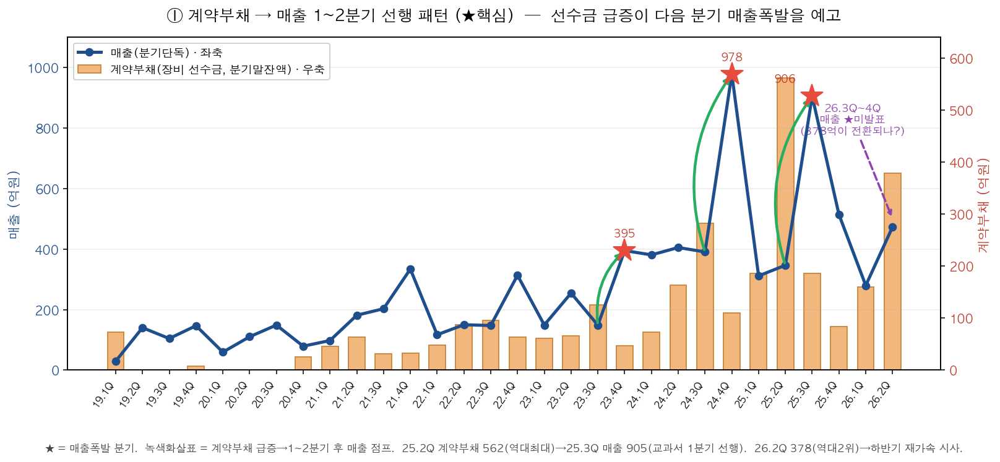
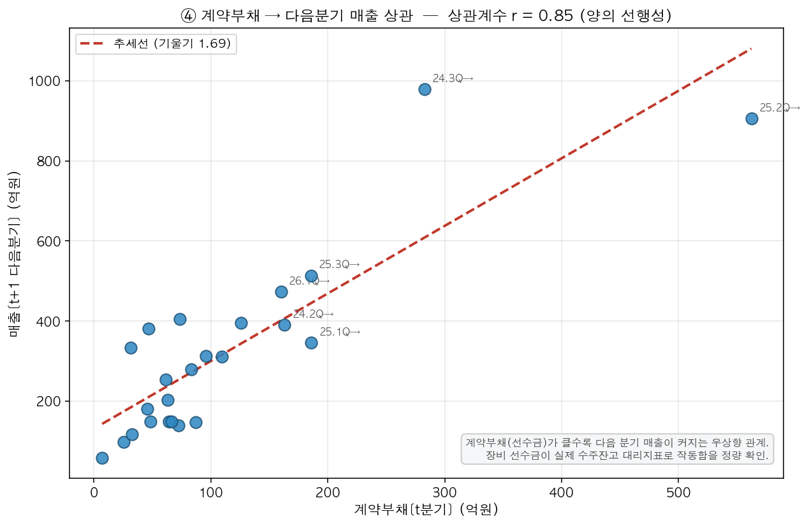
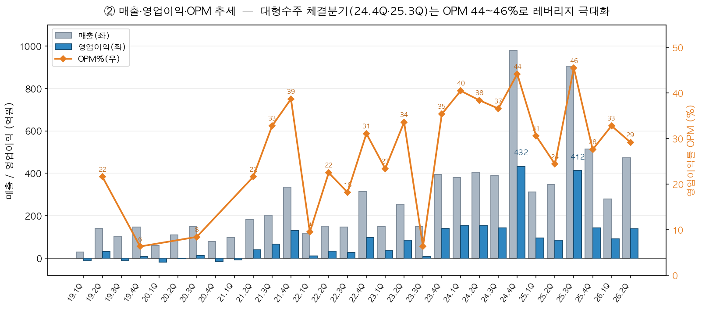
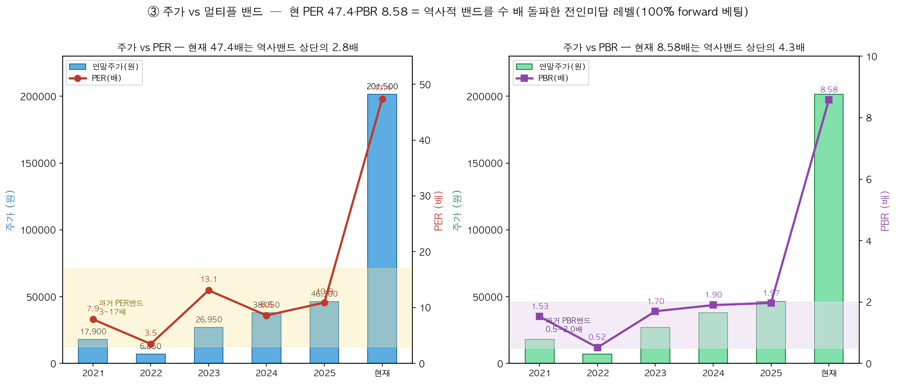

# 🔬 정밀 리서치 — 피에스케이홀딩스(031980) ※선물 有(레버리지 가능)

📌 **한줄 결론: 【관심】** 계약부채(장비 선수금)가 1~2분기 선행해 매출 폭발을 예고하는 패턴이 2023~2025년 내내 교과서적으로 반복 확인됨(계약부채↔다음분기 매출 **상관계수 r=0.85**). 26 2Q 계약부채 378억(역대 2위)은 26 하반기 매출 재가속을 강하게 시사. 단, **현 PER 47.4·PBR 8.58은 이 회사 역사상 최고 멀티플(과거 밴드 상단의 2.8~4.3배)로 100% forward 베팅** 구간 — 레버리지는 11월 중순 3Q보고서 실측 확인이 1차 관문.

- 현재가 **201,500원 / −3.82%** · 시총 **4.34조** · PER **47.4** · PBR **8.58** · EPS 4,252 · BPS 23,484 · 52주 40,500~219,000(**1년새 5.4배**) [KIS 실측]
- **개별주식선물 상장(근월물 A4B611) → 레버리지 매매 가능** [KIS 마스터 확인]

---

## ① 포착신호
- 1년새 저점 40,500 → 219,000, **5.4배 급등**. AI 후공정(어드밴스드 패키징) CoWoS·하이브리드본딩 CAPEX 슈퍼사이클 수혜주로 재평가.
- 증권사 목표가 상향 러시: 신한 26만("내년 매출 +75%"), 한화 BUY 신규 27만("영업이익 +175%"). 전부 **2027 추정 EPS에 forward PER 적용** — trailing 아님.

## ② 사업개요 — 왜 급등했나
- 반도체 **후공정(어드밴스드 패키징) 장비** 회사. 주력 = **디스컴(Descum, 감광막 잔류물 제거)·드라이스트립·HDH**.
- 전방 = 파운드리/OSAT의 **CoWoS·하이브리드 본딩** 등 AI 2.5D/3D 패키징. HBM·AI 가속기 CAPEX 확대 직접 수혜.
- ⚠️ **구조적 주의 2가지:**
  1. **수주잔고는 전 기간 "미공시"** — 34개 분기보고서 전부 "NDA·영업정책상 기재 생략"으로 숫자 자체가 비공개 [미확인·전기간 확정]. → **계약부채(장비 선수금)가 유일한 정량 수주 선행지표**.
  2. **2018 vs 2019~ 은 다른 회사** — 2018년 중 사업회사 인적분할 → 031980은 지주사 전환. 2018 매출 3,287억→2019 420억 급감은 악화가 아니라 분할 효과. **실질 분석은 2019년 이후.**

## ③ ★계약부채 → 매출 선행성 (재두형 핵심 — 비주얼)
**계약부채(장비 선수금)가 급증한 분기의 1~2분기 후 매출이 폭발**하는 패턴이 반복됩니다. 아래 차트에서 녹색 화살표가 "선수금 급증 → 다음 분기 매출 점프"를 직접 보여줍니다.

- 2023 3Q 계약부채 125.8억(직전 2배) → **2023 4Q 매출 395억**(148→395)
- 2024 3Q 282.6억(최대 경신) → **2024 4Q 매출 978억**(역대 최대)
- **2025 2Q 562.3억(역대최대) → 2025 3Q 매출 905억**(1분기 선행, 교과서 사례)
- **2026 2Q 378.5억(역대 2위) → 2026 3Q~4Q 🎯 아직 미발표(최대 관전 포인트)**

**정량 검증:** 계약부채[t분기] vs 매출[t+1 다음분기]의 산점도. **상관계수 r=0.85, 추세선 기울기 1.69** — 선수금이 100억 늘면 다음 분기 매출이 약 169억 늘어나는 우상향 관계. 장비 선수금이 비공개 수주잔고의 대리지표로 작동함을 수치로 확인.

→ **계약부채는 1~2분기 선행 매출 예고 지표로 신뢰도 높음.** 절대레벨보다 **직전 대비 급증 여부**가 핵심. 26 2Q 378억 → 26 하반기 매출 재가속 강하게 시사.

## ④ 매출·영업이익·OPM 추세 (비주얼)
대형수주 체결 분기(24.4Q·25.3Q)엔 매출이 900억대로 튀며 **OPM이 44~46%**까지 치솟습니다 — 장비주 특유의 고정비 레버리지. 반면 비수기 분기(25.2Q·26.2Q)는 25~29%로 눌립니다.

- 매출 피크: 24.4Q **978억**(역대최대), 25.3Q **905억**
- 영익 피크: 24.4Q **432억**, 25.3Q **412억**
- OPM 밴드: 호황분기 40~46% ↔ 비수기분기 25~33% (변동 큼 → 분기 믹스 중요)

## ⑤ 주가 vs 멀티플 밴드 (비주얼)
현 주가는 과거 PER/PBR 밴드를 **수직으로 돌파**한 전인미답 레벨입니다. trailing 실적으론 설명 불가 — 순수 2027 forward 베팅 구간.

연말주가 / EPS / PER / PBR [DART+KIS]:
- 2021 17,900 / 2,278 / 7.9 / 1.53
- 2022 6,850 / 1,982 / 3.5 / 0.52(바닥)
- 2023 26,950 / 2,055 / 13.1 / 1.70
- 2024 38,050 / 4,444 / 8.6 / 1.90
- 2025 46,300 / 4,252 / 10.9 / 1.97
- **현재 201,500 / 4,252 / PER 47.4 / PBR 8.58**

**밴드 해석:** 과거 PER **3배(바닥)~17배(천장)**, 중앙 8~10배. PBR **0.5~2.0배**, 중앙 1.5배. → **현 PER 47.4는 역사밴드 상단의 2.8배, PBR 8.58은 4.3배 돌파.**

**리레이팅 변곡점:** ①2023.6~7 HBM 테마 최초반영(PER 3→17) ②2024 상반기 OPM 40% 입증으로 실적이 멀티플 추격 ③**2026 현재 — trailing EPS로는 PER 47 전혀 설명 불가, 순수 2027 실적 선반영(forward 베팅).**

## ⑥ ★분기별 원본 데이터 테이블 (2019 1Q~2026 2Q, 연결 CFS)
단위 억원 · 매출/영익은 분기 단독값(누적 차분 [검산]) · 계약부채는 분기말 잔액. (위 차트들의 근거 숫자)

- 2019 1Q 매출 29.4 / 영익 −12.6 / 적자 · 계약부채 72.5(분할 과도기) [DART]
- 2019 2Q 140.2 / 30.3 / 21.6% [검산]
- 2019 3Q 104.4 / −12.2 / 적자 [검산]
- 2019 4Q 146.8 / 9.2 / 6.3% · 계약부채 7.1 [검산/DART]
- 2020 1Q 59.4 / −17.6 / 적자 [DART]
- 2020 2Q 110.3 / −2.5 / 적자 [검산]
- 2020 3Q 148.9 / 12.5 / 8.4% [검산]
- 2020 4Q 79.1 / −17.1 / 적자 · 계약부채 25.6 [검산/DART]
- 2021 1Q 97.9 / −8.8 / 적자 · 계약부채 45.7 [DART]
- 2021 2Q 181.4 / 39.3 / 21.6% · 계약부채 63.2 [검산/DART]
- 2021 3Q 203.0 / 66.7 / 32.8% · 계약부채 31.5 [검산/DART]
- 2021 4Q 333.9 / 129.2 / 38.7% · 계약부채 32.6 [검산/DART]
- 2022 1Q 117.0 / 11.1 / 9.5% · 계약부채 48.1 [DART]
- 2022 2Q 150.0 / 33.7 / 22.5% · 계약부채 87.2 [검산/DART]
- 2022 3Q 147.4 / 26.8 / 18.2% · 계약부채 95.6 [검산/DART]
- 2022 4Q 313.5 / 97.4 / 31.1% · 계약부채 64.1 [검산/DART]
- 2023 1Q 149.1 / 35.0 / 23.4% · 계약부채 61.3 [DART]
- 2023 2Q 254.5 / 85.4 / 33.6% · 계약부채 66.2 [검산/DART]
- 2023 3Q 148.6 / 9.3 / 6.3% · **계약부채 125.8(직전 2배↑)** [검산/DART]
- 2023 4Q 395.0 / 140.0 / 35.4% · 계약부채 46.6 [검산/DART]
- 2024 1Q 380.9 / 154.2 / 40.5% · 계약부채 73.2 [DART]
- 2024 2Q 405.2 / 155.7 / 38.4% · 계약부채 163.1 [검산/DART]
- 2024 3Q 390.6 / 142.8 / 36.6% · **계약부채 282.6(분기최대 경신)** [검산/DART]
- 2024 4Q **978.3 / 432.1 / 44.2%(역대 분기 최대)** · 계약부채 109.4 [검산/DART]
- 2025 1Q 311.5 / 95.4 / 30.6% · 계약부채 185.9 [DART]
- 2025 2Q 346.6 / 84.5 / 24.4% · **계약부채 562.3 🔺역대최대** [검산/DART]
- 2025 3Q **905.5 / 412.4 / 45.5%** · 계약부채 185.5 [검산/DART]
- 2025 4Q 514.0 / 141.7 / 27.6% · 계약부채 83.5 [검산/DART]
- 2026 1Q 279.8 / 91.7 / 32.8% · 계약부채 159.9 [DART]
- 2026 2Q 473.2 / 138.0 / 29.2% · **계약부채 378.5 🔺역대 2위** [검산/DART]

[검산] 로직: 2Q단독=반기누적−1Q, 3Q=3Q누적−반기, 4Q=연간−3Q누적. 전부 연결(CFS). 수주잔고 = 전 기간 n/a(DART 기재생략) [미확인]. (2018년 데이터는 인적분할 전/과도기라 추세분석에서 제외)

## ⑦ 🎯 매매포인트 (선물 有 · 레버리지 전제)
**1차 관문 — 2026 3Q보고서(11월 중순):**
1. **26 3Q 매출** — 26 2Q 계약부채 378억이 매출 전환됐는지. 과거 패턴(25 2Q 562→25 3Q 905)상 **700억+ 로 튀면 선행지표 적중 = 상승논리 유지.** 안 튀면 멀티플 붕괴 1순위 경고.
2. **26 3Q말 계약부채** — 다시 400억+ 급증이면 26 4Q~27 1Q 재가속 예고. **100억대로 꺾이면 수주 피크아웃 경고 → 선물 레버리지 즉시 축소.**
3. **OPM 40%+ 복귀 여부**(25 2Q·26 2Q는 25~29%로 눌림).

**⚠️ 밸류 부담(솔직히):**
- 현 PER 47·PBR 8.58 = 회사 역사상 최고, 100% forward 베팅. **실적 소폭 하회만으로도 멀티플 디레이팅(47→30)만으로 −35% 급락 가능 — 밸류 쿠션 없음.**
- 1년 5.4배 상승 = 변동성 극단. 레버리지는 반드시 분할·기계적 손절.
- 장비주는 **계약부채 꺾임(수주 피크아웃)이 주가 고점을 1~2분기 선행**(2022 사례). 계약부채가 조기경보 레이더.

**요약:** 추세·테마는 강력, 밸류는 극단. **26 3Q 매출 + 26 3Q말 계약부채 재급증**이 레버리지 유지/청산 분기점. 확인 전 신규 레버리지는 과열, 보유분은 트레일링 스톱.

---
*DART·KIS 실측 기반 리서치 자료, 투자권유 아님. 선물 레버리지는 원금초과손실 가능 → 포지션·손절 관리 필수.*

<!-- hub:enrich:begin -->

## 📐 실전 체크 (자동 실측 · KIS 2026-10-12 10:34 · 추정 0건)

*리포트 적재 시 허브가 KIS API로 자동 산출한 블록. 본문 수치와 다르면 이 블록이 최신.*

**시세 위치**
- 현재가 195,400원 (-6.7%) · 시총 4.21조 · 5일 +0.7% / 20일 +33.4% / 60일 +43.5%
- MA5 199,900원 / MA20 174,580원 / MA60 136,268원 → MA20 이격 +11.9% · MA60 이격 +43.4%
- 52주 고 219,000원 / 저 40,500원 → 고점 대비 -10.8% · 20일 고 209,500원 / 저 152,400원
- 후행 PER 45.95 / PBR 8.32 (EPS 4,252원 · BPS 23,484원)

**수급·유동성**
- 20일 평균 거래대금 313.8억 (5일 381.5억)
- 외국인 순매수 5일 32.6억 / 20일 173.0억 · 기관 5일 -10.4억 / 20일 -30.0억 · 개인 20일 -142.4억
- 개별주식선물: ⚡ 상장 (A4B610) → 레버리지 가능
- 공매도 비중: 당일 0.00% (공매도 0주 · 0.0억) · 5일 평균 4.13% / 20일 평균 5.13% → 감소 · 20일 평균 상회 연속 0일
- 공매도 20일 최대 12.12% (09/14) · 판정: 공매도 압력 높음(20일 평균 5%↑) · 잔고는 KIS 미제공(거래량 비중 기준, 38영업일)

*출처: KIS OpenAPI(현재가 FHKST01010100·일봉 FHKST03010100·투자자별 FHKST01010900·공매도 FHPST04830000, 투자자 데이터 30영업일) · 한투 개별주식선물 마스터. 값 조작·추정 없음.*

<!-- hub:enrich:end -->
